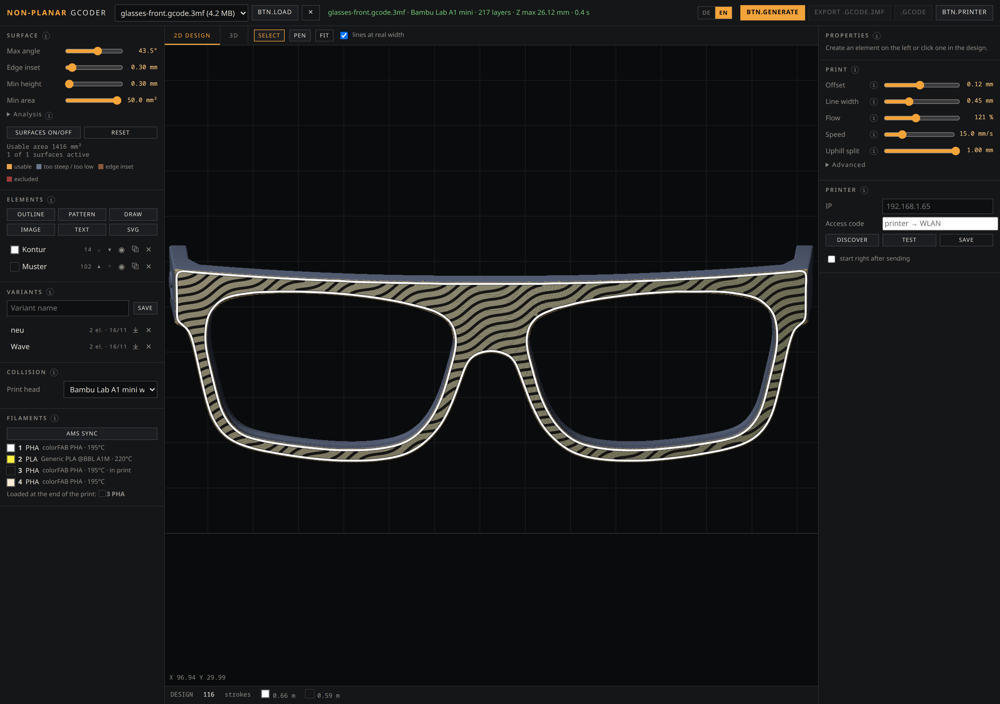
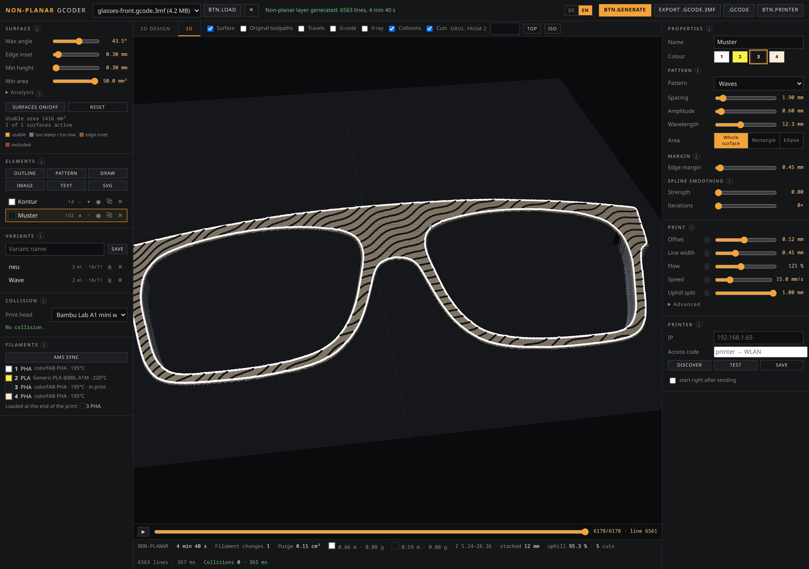
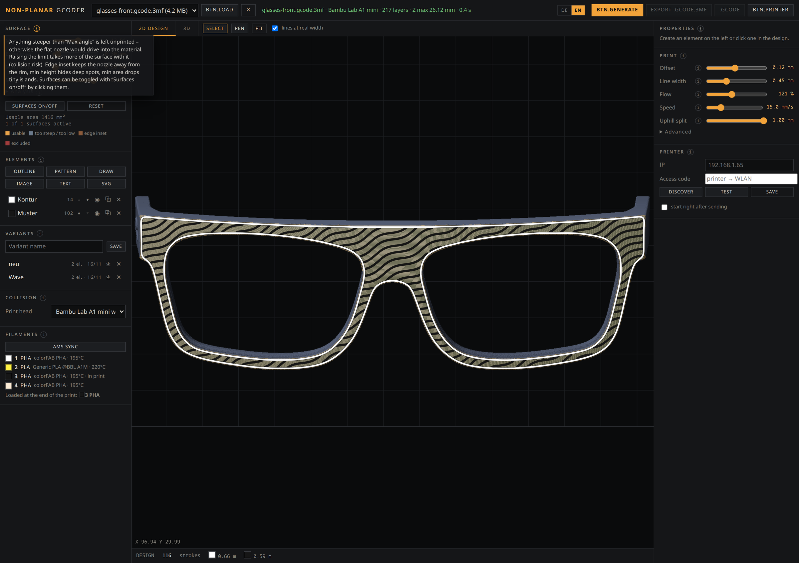

<p align="center">
  
</p>

# Non-Planar Gcoder

**Add one non-planar decoration layer to an already sliced Bambu Studio print – in the browser.**

You keep slicing in Bambu Studio. This app takes the finished `.gcode` or `.gcode.3mf`, works out
the surface of the part, lets you draw decoration on it (outlines, patterns, text, images, SVG)
and writes a merged `.gcode.3mf` back with a single extra non-planar pass before the end G-code.
The nozzle follows the real surface while it prints the decoration – over the rim of a lens, along
a curved housing, across a tapered front.

The example part in the screenshots is a compostable eyewear front from
[augenrahmen.de](https://augenrahmen.de) (100 % PHA, printed in Berlin).

<p align="center">
  
</p>

## Why

Full non-planar slicing (PancakeSlicer / Orca) put the whole print into a different engine and the
result did not meet the print quality of Bambu Studio. This tool takes the opposite route: the
model is sliced perfectly normally, and only the last decorative pass is generated non-planar.
The original G-code stays untouched; the new block is inserted right before the printer's end
G-code.

## Features

- **Surface analysis from above** – height map of the topmost toolpaths on a 0.1 mm grid, angle
  from the smoothed height, nozzle radius, edge inset, minimum height and minimum area. Surfaces
  can be included and excluded with a click.
- **Elements**: contour, patterns (lines, grid, waves, zigzag, curls, circles, spiral, dots,
  diamonds), freehand drawing, images (PNG/JPG, k-means colour separation), text and SVG.
  Move, scale, rotate, recolour; crop and tile images and text.
- **Order is the stack** – the element list is the print order. The top entry is printed last and
  therefore lies on top. Every element is placed on the best available support automatically,
  including partial overlaps: `z = max(surface + offset, line below + offset)`.
- **Uphill printing** – each section between two travels is printed so the nozzle climbs the
  surface instead of pushing material down. Strokes are split at crests (zigzag hysteresis, 3-point
  median against layer steps); threshold `0` splits every wave. Stats show the uphill share, the
  number of cuts and the descent that is left.
- **Nozzle follows the surface** – the height is the maximum of the surface under the whole nozzle
  disc plus the offset (`z_offset` can be negative). Crossings are lifted over lines already
  printed, the flow can adapt to the real gap under the nozzle.
- **Filament changes from the printer profile** – the profile's own `change_filament_gcode` is
  expanded with the Bambu purge matrix and multiplier; the colour order is chosen for minimal
  purge.
- **Optional collision check** – every move is tested against the printed model using the print
  head envelopes from PancakeSlicer (nozzle cone, heater sock, ducts, gantry). Hit boxes turn red
  in the x-ray view. The A1 mini presets include a variant **without the part cooling fan**.
- **3D preview with playback** – surface, original toolpaths, generated G-code, travels, cuts,
  collision markers, x-ray print head and the G-code view follow the slider.
- **Send to the printer, AMS only** – uploads the merged `.gcode.3mf` over FTPS and starts it over
  MQTT. Every filament used by the object *and* by the non-planar layer is mapped to an AMS tray
  (colour + material first, a free tray after that). If a filament cannot be mapped or the AMS
  cannot be read, the start is refused instead of falling back to the external spool.
- **English / German UI** with a language selector; every explanation lives in a hover tooltip
  (the small `i`) instead of taking space next to the controls.

<p align="center">
  
</p>

## Quick start

```bash
git clone https://github.com/3p1cball-code/non-planar-gcoder.git
cd non-planar-gcoder
python3 -m venv .venv
.venv/bin/pip install -r requirements.txt
.venv/bin/python -m npg.server
```

Open <http://localhost:6868>.

| Variable | Default | Meaning |
|---|---|---|
| `NPG_PORT` | `6868` | HTTP port |
| `NPG_HOST` | `0.0.0.0` | bind address (use `127.0.0.1` for local only) |
| `NPG_DATA` | `./data` | uploads, designs, variants, printer settings |

Run it as a systemd user service (autostart, restart on failure):

```bash
cp deploy/npgcoder.service ~/.config/systemd/user/
systemctl --user daemon-reload
systemctl --user enable --now npgcoder
```

`deploy/deploy.sh user@host` syncs the working tree to another machine, installs the
requirements and restarts the service there.

## Workflow

1. **Load** a Bambu `.gcode` or a sliced `.gcode.3mf` (plate selector for multi-plate files).
2. **Surface** – set the maximum angle, edge inset, minimum height and area. The drawing shows
   what is usable (amber), too steep or too low (grey) and excluded (red). Refine σ and the nozzle
   radius under *Analysis*.
3. **Elements** – add contours, patterns, drawings, images, text or SVG. Everything is clipped to
   the usable surface live; each element has its own margin and optional spline smoothing.
4. **Generate** – the G-code block is built, the optional collision check runs, and the 3D view
   opens with playback. The status bar shows time, filament changes, purge, uphill share, cuts and
   collisions.
5. **Export** as `.gcode.3mf` or `.gcode`, or **send** it to the printer (AMS only).

Designs and named variants are stored per file and plate, so switching between ideas is one click.
`Ctrl+Z` / `Ctrl+Y` undo and redo.

## How it works

**Surface.** The parser replays the sliced file and collects the uppermost extrusion segments.
A height map is built from above (0.1 mm cells), invalid cells are filled, the height is smoothed
(σ) and the angle is derived from the gradient. Steeper than the limit, deeper than the minimum
height or smaller than the minimum area is not printable. The nozzle radius is handled as a disc
maximum, so the nozzle cannot clip a step.

**Decoration layer.** Every element becomes polylines in bed coordinates. They are clipped to the
mask (minus the element margin), optionally smoothed and simplified, then resampled at `step`.
`z` is the maximum of the surface under the nozzle disc plus `z_offset`, raised over previously
printed non-planar lines, with ramps across crossings. Extrusion is derived from the line width and
the real gap below the nozzle; speed is capped by the filament's maximum volumetric speed.
Travels lift over the highest point along their path.

**Uphill split.** For each section the surface height along the path is examined. A local crest
that runs more than the split threshold against the print direction cuts the section; both halves
are printed from their lower end. A 3-point median ignores single layer steps, `dir_end_len` keeps
cuts away from stroke ends and `dir_cap` optionally limits the number of parts. Every cut is
written to the G-code as `; npg section …`, drawn as a dot in the 2D view and as a cross in 3D.

**Merge.** The block is inserted before Bambu's end G-code. The header, layer count, time estimate,
`M73` progress, the end Z and – for `.gcode.3mf` – `slice_info.config`, `plate_<n>.json` and the
MD5 are updated. Filament use is added to the totals.

## Printer

Tested with a Bambu Lab A1 mini in LAN mode. Enter IP and access code under *Printer* (the access
code is stored Fernet-encrypted in the data directory, never in the repository). *Discover* scans
the network for port 990; *Test* checks FTPS and MQTT and reads the serial number.

Starting a job uses the AMS only. The mapping is resolved before the upload:

| Job filament | AMS tray |
|---|---|
| same colour and material | that tray |
| same colour | that tray (flagged) |
| same material | that tray (flagged) |
| anything else | a free tray, never the external spool |
| fewer trays than filaments | the job is not started |

Nothing is sent to a printer that is currently printing; the app only uploads and, when enabled,
starts a new job.

## Collision check

`npg/heads/` contains 56 head envelopes from [PancakeSlicer](https://github.com/zimengxiong/PancakeSlicer)
(AGPL-3.0) as axis-aligned boxes in the nozzle-tip frame. The check samples each move, tests the
nozzle cone and the boxes against the height map and reports the hit boxes and depth. The profiles
are conservative envelopes, not exact CAD. Three derived presets drop the part cooling fan and its
duct for machines where that assembly is removed
(`tools/make_head_variants.py`).

## HTTP API

The web UI is a static app on top of a small FastAPI backend. Useful endpoints:

```
POST /api/upload                              upload .gcode / .gcode.3mf
GET  /api/job/{id}?plate=2                    metadata, filaments, defaults
GET  /api/job/{id}/grid?plate=2&sigma=&tip=   height map + mask (binary)
POST /api/job/{id}/generate?plate=2           {params, paths, head} -> stats, moves, gcode
GET  /api/job/{id}/export?plate=2&fmt=3mf     merged download
POST /api/job/{id}/send?plate=2               {start} -> FTPS upload (+ MQTT start)
GET  /api/printer/status                      state, progress, AMS trays
```

The `X-NPG-Lang: de|en` header selects the language of backend messages.

## Limits

- One decoration pass on top of a normal print – not a general non-planar slicer.
- Self-crossings inside a single stroke (loops) are not lifted; crossings *between* strokes are.
- On slopes the flat nozzle sits higher than the tip by `nozzle radius × tan(angle)`; `z_offset`
  and the gap flow compensate for that. Very steep areas are excluded by the angle limit.
- The head envelopes are simplified boxes; the collision check is a warning, not a guarantee.
- Printer integration is targeted at Bambu Lab (FTPS + MQTT + AMS). Other printers can still use
  the exported G-code if they understand it.

## Tests

```bash
.venv/bin/python -m pytest -q
```

113 tests cover the G-code parser, height map, path/pattern generation, uphill splitting, the
collision check, filament changes (rendered against a real Bambu tool-change block), the AMS
mapping and the HTTP API (including send and variants). The UI has no test runner; a JS syntax
check and manual browser runs are used instead.

## License

AGPL-3.0-or-later. The head profiles in `npg/heads/` come from PancakeSlicer (AGPL-3.0) and
require the same license; see `npg/heads/ATTRIBUTION.md`. three.js is MIT, FastAPI, uvicorn,
numpy, scipy and paho-mqtt keep their own licenses.

No telemetry, no accounts, no cloud: uploads, designs and printer settings stay in `data/`.
